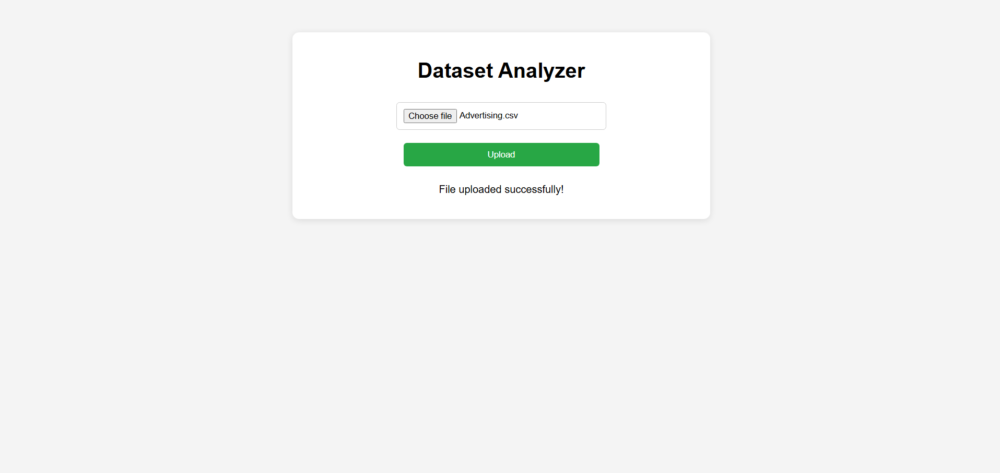
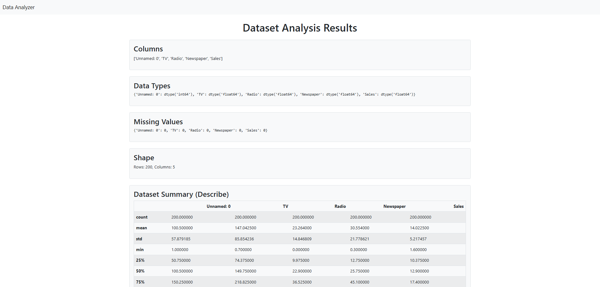
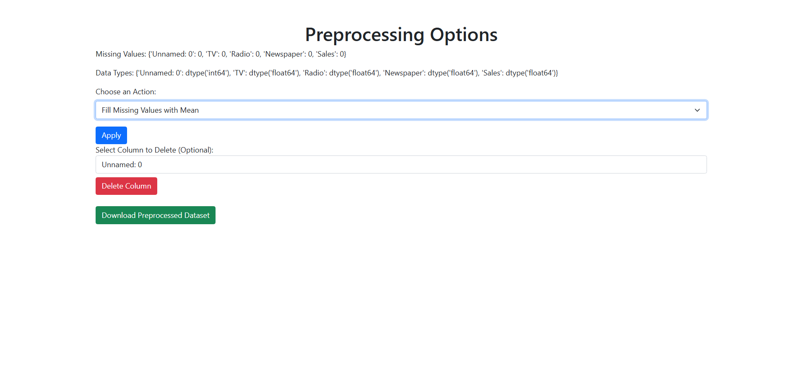
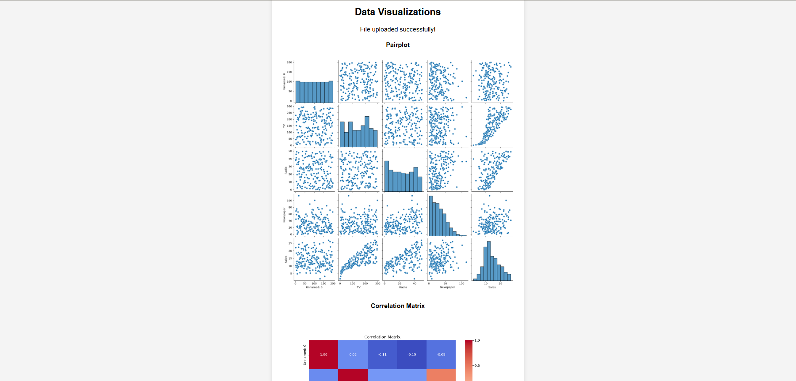
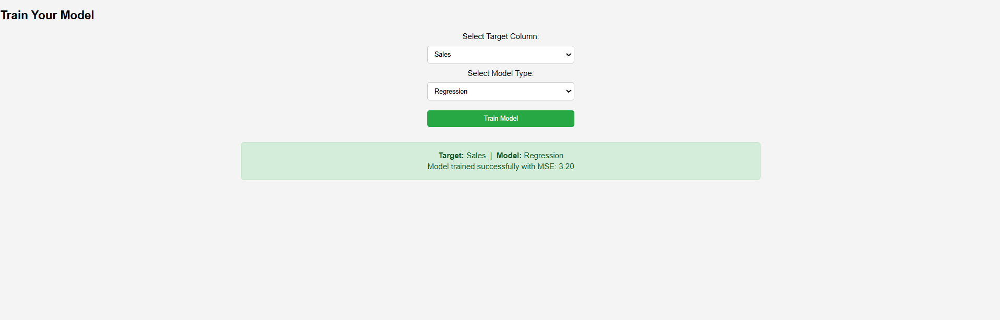

# Dataset Analyzer ML Platform

A Flask web application for exploring a CSV dataset, preprocessing it, visualizing it, and training a baseline machine learning model, all from the browser. Upload a file, inspect it, clean it, plot it, pick a target column, and get an accuracy or MSE score.


---

## Table of Contents
- [Features](#features)
- [Screenshots](#screenshots)
- [How It Works](#how-it-works)
- [Machine Learning Details](#machine-learning-details)
- [Tech Stack](#tech-stack)
- [Project Structure](#project-structure)
- [Installation](#installation)
- [Usage](#usage)
- [Limitations](#limitations)
- [Future Enhancements](#future-enhancements)
- [Author](#author)

---

## Features

| Area | What it does |
|---|---|
| **Upload** | Accepts CSV files and loads them with Pandas |
| **Analysis** | Shows column names, data types, missing values per column, shape, summary statistics, and the first and last rows |
| **Preprocessing** | Drop rows with missing values, fill missing values with the column mean, min-max normalization, label encoding of text columns, and column deletion |
| **Visualization** | Generates a pair plot, a correlation heatmap, and a box plot of the numeric features |
| **Model training** | Trains a classification or regression model on a target column you choose, and reports accuracy or MSE |
| **Model saving** | Saves the trained model to `model.pkl` using Joblib |

<!-- TODO: after you add screenshots to a screenshots/ folder, delete this line and the matching line below.
## Screenshots

| Upload | Dataset analysis |
|---|---|
|  |  |

| Preprocessing | Visualizations |
|---|---|
|  |  |


-->
## Screenshots

Screenshots coming soon.

## How It Works

```
Upload CSV -> Analyze -> Preprocess -> Visualize -> Select target -> Train model -> Accuracy / MSE
```

| Page | Route | Purpose |
|---|---|---|
| Home | `/` | Upload a CSV file |
| Analyze | `/analyze` | Dataset summary and missing value report |
| Preprocess | `/preprocess` | Apply cleaning and encoding steps to the loaded dataset |
| Visualize | `/visualize` | Generate and display plots |
| Train | `/train` | Choose a target column and model type, then train and evaluate |

## Machine Learning Details

| Step | Implementation |
|---|---|
| Split | 80% train, 20% test (`train_test_split`, `random_state=42`) |
| Scaling | `StandardScaler`, fitted on the training split only |
| Classification | `RandomForestClassifier`, evaluated with accuracy |
| Regression | `LinearRegression`, evaluated with mean squared error (MSE) |
| Saving | Trained model saved to `model.pkl` with Joblib |

Features must be numeric before training, so apply label encoding on the Preprocess page first if your data has text columns.

## Tech Stack

| Area | Tools |
|---|---|
| Language | Python |
| Web framework | Flask |
| Data handling | Pandas, NumPy |
| Visualization | Matplotlib, Seaborn |
| Machine learning | Scikit-learn |
| Model saving | Joblib |
| Deployment file | Gunicorn, `Procfile` |

## Project Structure

```
.
├── app.py              # Flask routes: upload, analyze, preprocess, visualize, train
├── models.py           # Database models
├── templates/          # HTML pages
├── static/             # CSS and generated plots
├── uploads/            # Uploaded CSV files (created at runtime)
├── Procfile            # Process file for deployment platforms
├── requirements.txt    # Python dependencies
├── .gitignore
└── README.md
```

## Installation

```bash
# 1. Clone the repository
git clone https://github.com/devanbeeda/dataset-analyzer-ml-platform.git
cd dataset-analyzer-ml-platform

# 2. (Optional) create a virtual environment
python -m venv venv
source venv/bin/activate        # Windows: venv\Scripts\activate

# 3. Install dependencies
pip install -r requirements.txt

# 4. Run the app
python app.py
```

Open `http://127.0.0.1:5000` in your browser.

## Usage

1. **Upload** a CSV file on the home page.
2. **Analyze** the dataset to check types, missing values, and statistics.
3. **Preprocess**: fill or drop missing values, label-encode text columns, normalize numeric columns, or delete unneeded columns.
4. **Visualize** the numeric features with the pair plot, correlation heatmap, and box plot.
5. **Train**: choose the target column and either classification or regression, then read the accuracy or MSE on the test split.

## Limitations

- The uploaded dataset is held in server memory, so the app supports **one user and one dataset at a time**. It is a learning and demo tool, not a multi-user service.
- Only two baseline models are offered (Random Forest and Linear Regression), with default settings. There is no hyperparameter tuning, cross-validation, or model comparison yet.
- Training expects numeric features, and missing values and text columns must be handled in the Preprocess step first.
- Accuracy and MSE come from a single train-test split, so scores can vary with a different split.
- Only the model is saved. The fitted scaler is not stored, so the saved model cannot be reused on new data without recreating the same scaling.

## Future Enhancements

- Model comparison with cross-validation and hyperparameter tuning
- More metrics (precision, recall, F1, ROC-AUC, R-squared)
- Per-session datasets instead of one shared dataset
- Exporting the cleaned dataset
- Saving the scaler together with the model
- Cloud deployment

## Author

**Devan Beeda**
[LinkedIn](https://www.linkedin.com/in/devanbeeda/) | [GitHub](https://github.com/devanbeeda) | devanbeeda@gmail.com
